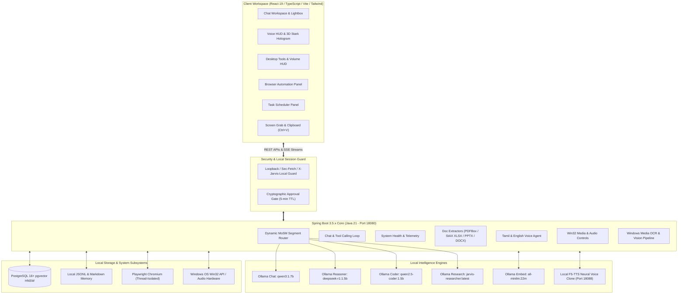

# JARVIS AI

> **A sovereign, local-first personal artificial intelligence assistant engineered with Java 21, Spring Boot, React, and local Ollama models.**
> Features DeepSeek-R1 cognitive reasoning, hands-free wake word with instant voice barge-in, zero-shot neural voice cloning, multi-format RAG (PDF, DOCX, XLSX, PPTX), Model Context Protocol (MCP) tool execution with cryptographic approval gates, thread-isolated browser automation, desktop system controls, and continuous autonomous self-training.

---

## Table of Contents

1. [System Architecture](#system-architecture)
2. [Project Directory Structure](#project-directory-structure)
3. [Current Scope & Implemented Capabilities](#current-scope--implemented-capabilities)
4. [How to Run the Project](#how-to-run-the-project)
   - [⚡ Quick Start (Single-Command Run)](#-quick-start-single-command-run)
   - [Prerequisites](#prerequisites)
   - [Step 1: Start Ollama & Download Local Models](#step-1-start-ollama--download-local-models)
   - [Step 2: Build & Package the Application](#step-2-build--package-the-application)
   - [Step 3: Run Modes (Production vs Developer)](#step-3-run-modes-production-vs-developer)
   - [Step 4: Verify System Health](#step-4-verify-system-health)
   - [Step 5: (Optional) Local Neural Voice Cloning Setup](#step-5-optional-local-neural-voice-cloning-setup)
   - [Step 6: (Optional) PostgreSQL & pgvector Setup](#step-6-optional-postgresql--pgvector-setup)
   - [Step 7: Autonomous Model Training (jarvis-researcher)](#step-7-autonomous-model-training-jarvis-researcher)
   - [🛠️ Troubleshooting & Common Fixes](#️-troubleshooting--common-fixes)
5. [Automated Testing & Benchmarks](#automated-testing--benchmarks)
6. [Security & Privacy Architecture](#security--privacy-architecture)

---

## System Architecture

JARVIS AI is built on a **local-first, zero-cloud dependency architecture** designed to keep all prompts, document vectors, biometric templates, and telemetry strictly on your machine.



### Core Architecture Subsystems

1. **Mixture of Specialized Models (MoSM) Router (`SegmentRouter.java`)**:
   Automatically inspects incoming queries and routes them to specialized small models without manual user selection:
   - **Mathematical & Deduction**: Routed to `deepseek-r1:1.5b` with strict `<think>...</think>` cognitive scratchpad tags.
   - **Code & Compiler Errors**: Routed to `qwen2.5-coder:1.5b`.
   - **Real-Time Markets & Live Facts**: Routed to `jarvis-researcher:latest` with live Yahoo Finance and web retrieval.
   - **Conversational & Multi-Lingual**: Routed to `qwen3:1.7b` with native Tamil, English, and dynamic language mirroring.

2. **Instant Fluid Voice Pipeline (`wakeWordEngine.ts`, `TamilVoiceAgent.java`)**:
   - **Sub-50ms Voice Barge-In**: User speech detected mid-response halts synthesis instantly and redirects to the new intent.
   - **Acoustic Self-Echo Rejection (AEC)**: Hardware echo cancellation combined with active utterance buffer matching prevents JARVIS from interrupting itself.
   - **Ambient Hands-Free Wake Word**: Constantly listens for *"Hey Jarvis"* or *"ஹே ஜார்விஸ்"* with one-breath command execution (*"Hey Jarvis, check memory"*).
   - **Attentive Multi-Turn Window**: Stays in an attentive listening state for 5 seconds after each answer for natural follow-ups without repeating the wake word.

3. **Multi-Format Local RAG & Vector Engine (`003_pgvector_rag.sql`, `LocalFiles.java`)**:
   - Ingests TXT, Markdown, PDF (page-accurate), DOCX, XLSX spreadsheets (multi-sheet cell matrices), and PPTX presentations (slide-by-slide).
   - Local chunking (~256 tokens with 32-token overlap) and SHA-256 deduplication.
   - Bounded local embedding generation via `all-minilm:22m` (384-dimensional vectors) stored in PostgreSQL with HNSW indexing and cosine similarity.

4. **Model Context Protocol (MCP) & Safe Automation**:
   - Discovers MCP stdio tools over JSON-RPC 2.0 with JSON Schema validation.
   - Enforces cryptographic challenge tokens (5-minute TTL) for consequential operations (`delete`, `write`, `exec`) through the interactive UI approval modal.
   - Thread-isolated Playwright browser automation with RFC 1918 loopback/private subnet SSRF blocking.

5. **Desktop System Controls & Screen Vision**:
   - Native Win32 media key triggers (`VK_MEDIA_PLAY_PAUSE`, `VK_MEDIA_NEXT_TRACK`, etc.) and master hardware volume control (0–100%).
   - Direct screen grab and clipboard paste (`Ctrl + V`) with Windows Media OCR to extract compiler errors and code blocks for immediate debugging.

6. **Native System Tray & Global Background Wake-Word Engine (Immersion)**:
   - **Lightweight System Tray Daemon (`scripts/tray_wakeword.py`)**: Runs persistently in the Windows Notification Area with a dynamic Arc Reactor icon (cyan when listening, amber when active, slate when muted).
   - **Neural Wake-Word & Silero VAD (`openWakeWord`, `Silero VAD`)**: Continuously monitors default Windows audio input for *"Hey Jarvis"* with ~0.8% CPU footprint and zero false-positive acoustic gating.
   - **Full-Screen Desktop Immersion**: Uses Win32 thread elevation (`AttachThreadInput`, `SetForegroundWindow`, `SW_RESTORE`) to immediately pop up JARVIS over fullscreen games (e.g. Valorant, Steam), code editors (VS Code), or terminal windows the instant the wake word is detected.
   - **Sub-50ms Reactive Event Stream**: Emits real-time wake events to `/api/v1/voice/wakeword/stream` via Server-Sent Events (SSE) so the browser HUD activates instantaneously.
   - **Dual-Mode Persistence & Audit Logging**: Records wake events, confidence scores, and foreground application telemetry to PostgreSQL (`database/007_background_wakeword.sql`) with local-first JSON fallback (`data/wakeword/`).

7. **Smart Home & IoT Automation Engine (`com.jarvis.smarthome`)**:
   - **Dual-Protocol Gateway**: Interconnects with local Home Assistant instances via REST & WebSocket APIs (`/api/states`, `/api/services/{domain}/{service}`) and local MQTT brokers (Mosquitto/EMQX) using lightweight pure Java socket MQTT v3.1.1 protocol.
   - **Embedded IoT Sandbox / Simulation Mode**: Zero-hardware dependency sandbox providing out-of-the-box virtual devices (Room Lighting, Desk Power Strip, Ceiling Light, Thermostat/AC, Temperature and Motion Sensors) and multi-device scenes.
   - **Simultaneous Macro Scenes**: One-command scene orchestration across multiple devices (Movie mode, Work mode, Night mode, Relax mode, Gaming mode).
   - **Natural Voice & Bilingual Parsing**: Direct conversational voice triggers in English and Tamil ("Jarvis, set room lighting to Movie mode", "Jarvis, turn off the desk power strip", "அறை விளக்குகளை மூவி மோடுக்கு மாற்று", "டெஸ்க் பவர் ஸ்ட்ரிப்பை ஆஃப் செய்").
   - **PostgreSQL & Local-First Persistence (`database/007_smarthome_devices_and_automations.sql`)**: Durable database tables for devices, scenes, telemetry audit logs, and broker credentials with local JSON fallback in `data/smarthome/`.

8. **Full Desktop GUI Agent Automation (`DesktopGuiAgentService.java`, `database/007_desktop_gui_automation.sql`)**:
   - **Autonomous Mouse & Cursor Actuation**: Precise coordinate movement (`x, y`), smooth interpolation, left/right/middle click, double click, dragging, and wheel scrolling via `java.awt.Robot` with PowerShell fallback.
   - **Keyboard & Hotkey Simulation**: High-reliability text typing via clipboard paste (supports multiline text, programming code, emojis, and Unicode like Tamil/Hindi without layout corruption), single keypresses (`ENTER`, `TAB`, `ESC`, `BACKSPACE`, `DELETE`, etc.), and complex hotkeys (`Ctrl+S`, `Ctrl+C`, `Ctrl+V`, `Ctrl+A`, `Alt+Tab`, `Alt+F4`, `Win+D`, `Ctrl+Shift+P`, `Ctrl+\``).
   - **Window & Application Management**: Enumeration of active interactive window handles (`title`, `processName`, `processId`), bringing any window directly to the foreground (`AppActivate` / `SetForegroundWindow`), graceful window closing, and desktop minimizing (`Win+D`).
   - **Database-Persisted Macro Sequences (`jarvis.desktop_workflows`)**: Durable multi-step workflows with configurable delays (e.g. *Quick Meeting Notes in Notepad*, *Developer Workspace Setup*, *Save Active Document*), execution tracking, and audit logging into `jarvis.desktop_action_audit`.
   - **Tactical Desktop GUI Agent Studio Panel**: Dual-tab UI in `DesktopToolsPanel.tsx` with active window manager cards, mouse/keyboard sandbox, macro sequence runner, and real-time audit log.

---

## Project Directory Structure

The tree below reflects the current local workspace. Package and component subfolders are collapsed for readability; generated dependencies, build outputs, and runtime data are not expanded recursively. File and folder names are preserved as they exist on disk.

```text
jarvis-ai/
├── .github/
├── .tools/  # Local tool and Maven dependency cache
├── .venv/  # Local Python virtual environment
├── .vscode/
├── backend/
│   ├── data/
│   ├── src/
│   │   ├── main/
│   │   │   ├── java/
│   │   │   │   └── com/
│   │   │   │       └── jarvis/
│   │   │   │           ├── ai/
│   │   │   │           ├── automation/
│   │   │   │           ├── biometrics/
│   │   │   │           ├── chat/
│   │   │   │           ├── common/
│   │   │   │           ├── config/
│   │   │   │           ├── database/
│   │   │   │           ├── files/
│   │   │   │           ├── goal/
│   │   │   │           ├── knowledge/
│   │   │   │           ├── mcp/
│   │   │   │           ├── rag/
│   │   │   │           ├── realtime/
│   │   │   │           ├── scheduler/
│   │   │   │           ├── security/
│   │   │   │           ├── shopping/
│   │   │   │           ├── smarthome/
│   │   │   │           ├── system/
│   │   │   │           ├── vision/
│   │   │   │           ├── voice/
│   │   │   │           │   ├── agent/
│   │   │   │           │   ├── clone/
│   │   │   │           │   ├── engine/
│   │   │   │           │   ├── model/
│   │   │   │           │   ├── tamil/
│   │   │   │           │   ├── wakeword/
│   │   │   │           │   ├── LanguagePreferenceService.java
│   │   │   │           │   ├── VoiceCommandDispatcher.java
│   │   │   │           │   ├── VoiceController.java
│   │   │   │           │   └── VoiceService.java
│   │   │   │           ├── web/
│   │   │   │           └── JarvisApplication.java
│   │   │   └── resources/
│   │   │       ├── static/  # Static resources
│   │   │       ├── application.yml  # Spring Boot application configuration
│   │   │       └── voice.ps1
│   │   └── test/  # Backend tests
│   ├── target/  # Generated classes, reports, and packaged JAR
│   └── pom.xml
├── data/  # Local runtime state and audit files; contents vary with usage
│   ├── backups/
│   ├── biometrics/
│   ├── goal-reports/
│   ├── smarthome/
│   ├── training/
│   ├── voices/
│   ├── wakeword/
│   ├── automation-audit.jsonl
│   ├── desktop-audit.jsonl
│   ├── file-memory.json
│   ├── goal-runs.json
│   ├── learned-knowledge.jsonl
│   ├── mcp-audit.jsonl
│   ├── metrics-history.jsonl
│   ├── scheduler-history.jsonl
│   └── scheduler-tasks.json
├── database/
│   ├── 001_tables_and_functions.sql
│   ├── 002_smoke_test_rollback.sql
│   ├── 003_pgvector_rag.sql
│   ├── 004_vector_search_fix.sql
│   ├── 005_vector_smoke_rollback.sql
│   ├── 006_biometric_profiles.sql
│   ├── 007_background_wakeword.sql
│   ├── 007_desktop_gui_automation.sql
│   ├── 007_goal_runs_multi_agent.sql
│   ├── 007_smarthome_devices_and_automations.sql
│   ├── 008_goal_smoke_test_rollback.sql
│   └── README.md
├── docs/
│   ├── API.md
│   ├── DATABASE_API.md
│   ├── HOW_TO_RUN.md  # Additional run guide
│   ├── LOCAL_FILES.md
│   ├── PLAN.md
│   ├── REQUIREMENTS.md
│   ├── VALIDATION.md
│   ├── VOICE.md
│   └── WEB_SEARCH.md
├── frontend/
│   ├── dist/  # Generated production UI bundled by Maven
│   ├── node_modules/  # Installed frontend dependencies
│   ├── src/
│   │   ├── components/
│   │   │   ├── chat/
│   │   │   ├── connection/
│   │   │   ├── layout/
│   │   │   ├── modals/
│   │   │   └── settings/
│   │   ├── panels/  # Panel components; some names also exist directly under src/
│   │   │   ├── AutomationPanel.tsx
│   │   │   ├── BiometricsPanel.tsx
│   │   │   ├── DatabaseMemoriesPanel.tsx
│   │   │   ├── DesktopToolsPanel.tsx
│   │   │   ├── FilesPanel.tsx
│   │   │   ├── GoalPlannerPanel.tsx
│   │   │   ├── SchedulerPanel.tsx
│   │   │   ├── ShoppingPanel.tsx
│   │   │   ├── SmartHomePanel.tsx
│   │   │   └── VoicePanel.tsx
│   │   ├── types/
│   │   ├── utils/
│   │   ├── api.test.ts
│   │   ├── api.ts
│   │   ├── App.tsx
│   │   ├── AutomationPanel.tsx
│   │   ├── BiometricsPanel.tsx
│   │   ├── ConversationsDrawer.tsx
│   │   ├── DatabaseMemoriesPanel.tsx
│   │   ├── FilesPanel.tsx
│   │   ├── GoalPlannerPanel.tsx
│   │   ├── JarvisHologram.tsx
│   │   ├── main.tsx
│   │   ├── McpApprovalModal.tsx
│   │   ├── SchedulerPanel.tsx
│   │   ├── ShoppingPanel.tsx
│   │   ├── style.css
│   │   └── VoicePanel.tsx
│   ├── index.html
│   ├── package-lock.json
│   ├── package.json
│   ├── run_human_browser_tests.cjs
│   ├── test_browser_human.cjs
│   ├── tsconfig.json
│   ├── tsconfig.tsbuildinfo
│   └── vite.config.ts
├── samples/
├── scripts/
│   ├── data/
│   ├── benchmark.ps1
│   ├── build.ps1  # Frontend tests/build and Maven verification
│   ├── generate-token.js
│   ├── java.ps1
│   ├── load-env.ps1
│   ├── migrate-shared-tools.ps1
│   ├── pull-model.ps1
│   ├── run.ps1  # Stops backend, optionally packages JAR, starts services
│   ├── session.ps1
│   ├── setup-voice-clone.ps1
│   ├── setup-wakeword.ps1
│   ├── start-backend.ps1
│   ├── start-ollama.ps1
│   ├── start-tray.ps1
│   ├── start-voice-clone.ps1
│   ├── test-backend.ps1
│   ├── test-database.ps1
│   ├── train_facts_model.py
│   ├── train-local-model.ps1
│   ├── tray_wakeword.py
│   ├── verify-local.ps1
│   └── voice_clone_server.py
├── verification-rag/
├── .env
├── .env.example
├── .gitignore
├── HOW_TO_RUN.md  # Root application run guide
└── README.md
```

---

## Current Scope & Implemented Capabilities

- **Local Chat & Fast Inference**: Single-request inference serialized with conservative memory budgeting (~384MB heap limit), total request deadlines, and arithmetic computation bypassing Ollama (`calculate: (12 + 8) * 3`).
- **Instant Fluid Voice Pipeline & Hands-Free Wake Word**:
  - **Sub-50ms Voice Barge-In**: User speech detected mid-response halts synthesis instantly and redirects to the new intent.
  - **Acoustic Self-Echo Rejection (AEC)**: Hardware echo cancellation combined with active utterance buffer matching prevents JARVIS from interrupting itself.
  - **Ambient Hands-Free Wake Word**: Constantly listens for *"Hey Jarvis"* or *"ஹே ஜார்விஸ்"* with one-breath command execution (*"Hey Jarvis, check memory"*).
  - **Attentive Multi-Turn Window**: Stays in an attentive listening state for 5 seconds after each answer for natural follow-ups without repeating the wake word.
- **DeepSeek-R1 Cognitive Reasoning & Dynamic MoSM Task Router**:
  - Dynamic routing (`SegmentRouter.java`) matches math, proofs, algorithms, and logic to `deepseek-r1:1.5b`.
  - Enforces DeepSeek-R1 temperature calibration (0.2) and strict scratchpad `<think>...</think>` tags for internal step-by-step logic.
  - Coding inquiries automatically directed to `qwen2.5-coder:1.5b`.
  - Dynamic UI badges (`🧠 DeepSeek-R1`, `📈 JARVIS-Researcher`, `💻 Coder`) with expandable thinking accordion.
- **PostgreSQL Persistence & UI**:
  - Saved conversation history drawer with pagination, session loading, snapshot creation, and deletion.
  - Relational memory panel for long-term fact storage with full CRUD and version tracking.
  - Schema migrations with Row-Level Security (`001_tables_and_functions.sql`).
- **RAG & Vector Embeddings (pgvector)**:
  - Multi-format ingestion: TXT, Markdown, PDF (page-accurate citations), DOCX, XLSX spreadsheets (StAX XML multi-sheet parsing), and PPTX presentations (slide-by-slide text).
  - Bounded document chunker (~256 tokens with 32-token overlap) and SHA-256 deduplication.
  - Local embedding generation via `all-minilm:22m` (384 dimensions) with concurrency locks.
  - HNSW cosine similarity search combined with exact keyword retrieval (`003_pgvector_rag.sql`).
- **Model Context Protocol (MCP)**:
  - Tool discovery and JSON Schema validation via Spring AI MCP Client over stdio transports.
  - Consequential tool heuristic (e.g. `delete`, `write`, `exec`) requiring cryptographically random challenge tokens with 5-minute TTL.
  - Human-in-the-loop interactive approval modal and audit logging to `data/mcp-audit.jsonl`.
- **Browser Automation (Playwright)**:
  - Dedicated single-threaded executor guaranteeing thread isolation.
  - Strict SSRF / private IP blocking (RFC 1918 `10.0.0.0/8`, `172.16.0.0/12`, `192.168.0.0/16`, `127.0.0.1`, `localhost`) and domain allowlists.
  - Interactive multi-step action builder (`CLICK`, `FILL`, `PRESS`, `WAIT_FOR`) with base64 visual snapshots and audit logging.
- **Dynamic Multi-Lingual Intelligence & Strict Language Mirroring**:
  - Strict language mirroring: English queries receive strictly English answers with English `<think>` reasoning; Tamil queries receive native Tamil script answers with Tamil `<think>` reasoning.
  - Automatic dynamic language switching via natural voice/text commands ("switch to English", "speak in Tamil", "தமிழில் பேசு", "switch to Hindi", "switch to French", etc.).
  - Cross-lingual prompt isolation preventing background memories from causing unintended language bleed.
- **Zero Prebuilt Answers & Model Deep-Thinking Architecture**:
  - Pure dynamic reasoning without hardcoded or pre-baked answers.
  - Transparent DeepSeek-style reasoning trace (`<think>...</think>`) exposing cognitive steps before responding.
  - Autonomous live web research (DuckDuckGo, Wikipedia) with continuous online learning and fact synthesis when context is missing.
- **Omnipresent Voice & Text Command Control**:
  - Global multimodal dispatcher executing biometrics, hardware diagnostics, web searches, browser automation, and goals directly through conversational voice and text prompts without locking users to individual UI pages.
- **Autonomous Goal Planner & Multi-Agent Parallel Task Execution**:
  - **Specialized Sub-Agent Squad**: Decomposes complex multi-step objectives into coordinated parallel roles:
    - 🔍 **Researcher Agent** (`RESEARCHER`): Web intelligence, live facts, technical specifications, market pricing, and workspace document retrieval.
    - 💻 **Coder Agent** (`CODER`): Reactive architecture design, production classes, service layers, and executable algorithm modules.
    - 🛡️ **Validator Agent** (`VALIDATOR`): Syntax verification, unit test suite derivation (`testHappyPathExecution`, `testBoundaryPayload`), boundary checking, and security audits.
    - ⚡ **System Analyst Agent** (`SYSTEM_ANALYST`): Hardware compute diagnostics, RAM heap, GPU headroom, and workspace dependency auditing.
    - 🎯 **Lead Coordinator Agent** (`COORDINATOR`): Multi-agent deliverable synthesis, milestone verification, and executive deliverable reports.
  - **Parallel Concurrency Engine**: Simultaneous execution of independent sub-agents within each stage using managed thread worker pools (`CompletableFuture.allOf`), dramatically reducing wall-clock execution latency.
  - **Interactive Concurrency HUD**: Live indicator showing actively executing sub-agents (`⚡ N Sub-Agents Running Simultaneously`), stage-by-stage pipelines, per-agent filtering, duration benchmarks, and formatted code viewers.
  - **PostgreSQL Persistence & Row-Level Security (`database/007_goal_runs_multi_agent.sql`)**: Durable relational storage for `jarvis.goal_runs` and `jarvis.goal_steps` with RLS (`owner_name = session_user`), automated rollback smoke tests (`008_goal_smoke_test_rollback.sql`), and resilient local-first JSON persistence fallback (`data/goal-runs.json`).
  - **Bilingual English & Tamil Support**: Native language intent recognition, sub-agent labels ("ஆராய்ச்சி முகவர்", "நிரலாக்க முகவர்", "சரிபார்ப்பு முகவர்"), and dual-language deliverable synthesis.
- **Native Windows System Tray & Global Background Wake-Word (Immersion)**:
  - **Dormant Background Listener**: Packageable lightweight Windows listener running in the notification area with a dynamic Arc Reactor icon (`scripts/tray_wakeword.py`).
  - **Hands-Free Desktop Immersion**: Say *"Hey Jarvis"* anywhere—even while coding in fullscreen VS Code or playing fullscreen games—and JARVIS instantly forces itself on top, plays an activation chime, and engages voice interaction.
  - **openWakeWord & Silero VAD Integration**: Ultra-low CPU footprint (<1%) with neural wake-word modeling and acoustic noise suppression.
  - **Sub-50ms Reactive Event Broadcast**: Backend publishes wake events via SSE (`/api/v1/voice/wakeword/stream`), opening the Iron Man HUD and initiating speech recognition immediately.
  - **Dual-Mode Persistence (`database/007_background_wakeword.sql`)**: Stores user wake-word configurations and logs trigger events (including active foreground process name and confidence) to PostgreSQL with offline local fallback (`data/wakeword/`).
- **Biometric Security & Hardware Telemetry**:
  - Multi-factor face mesh (128-d Euclidean embeddings) and voice acoustic authentication.
  - Live system diagnostics (CPU thread load, RAM heap, GPU VRAM, storage).
- **100% Free & Open-Source Zero-Shot Voice Cloning (F5-TTS)**:
  - Record a 5–10 second voice sample directly in the browser with live countdown and audio preview.
  - Zero cloud calls, zero subscriptions, 100% offline data privacy.
  - Generates speech matching your personal pitch, timbre, and cadence on your local RTX 2050 GPU (or CPU).
  - Curated Marvel/Stark AI Personas (J.A.R.V.I.S., F.R.I.D.A.Y., U.L.T.R.O.N., E.D.I.T.H., K.A.R.E.N., J.O.C.A.S.T.A., Iron Man Baritone, Tamil JARVIS).
- **Real-Time Fact Gathering, Financial Markets & Autonomous Model Training (`jarvis-researcher:latest`)**:
  - Live financial quotes (Nifty 50, BSE Sensex, S&P 500, Nasdaq, Bitcoin, and custom tickers) via free Yahoo Finance feed.
  - Live SVG sparkline trend charts and streaming cinema release cards (`/api/v1/realtime/chart`, `/api/v1/realtime/cinema-card`).
  - Millisecond-accurate system date, day of week, 12/24-hour time, and timezone.
  - Autonomous continuous self-training pipeline recording instruction pairs to `data/training/live_facts_dataset.jsonl`.
- **Desktop System Tools (Win32 Media, Volume, Voice App Launcher)**:
  - Windows media controls (`VK_MEDIA_PLAY_PAUSE`, `VK_MEDIA_NEXT_TRACK`, etc.) for Spotify, YouTube, VLC.
  - Master hardware volume slider (0–100%) with live mute status feedback.
  - Application launcher across Browsers, Development, Media, Productivity, Utilities, and custom URLs.
- **Full Desktop GUI Agent Automation (Option A: High Utility)**:
  - **Autonomous Mouse & Cursor Actuation**: Precise coordinate movement (`x, y`), smooth interpolation, left/right/middle click, double click, dragging, and wheel scrolling via `java.awt.Robot` with PowerShell fallback.
  - **Keyboard & Hotkey Simulation**: High-reliability text typing via clipboard paste (supports multiline text, programming code, emojis, and Unicode like Tamil/Hindi without layout corruption), single keypresses (`ENTER`, `TAB`, `ESC`, `BACKSPACE`, `DELETE`, etc.), and complex hotkeys (`Ctrl+S`, `Ctrl+C`, `Ctrl+V`, `Ctrl+A`, `Alt+Tab`, `Alt+F4`, `Win+D`, `Ctrl+Shift+P`, `Ctrl+\``).
  - **Window & Application Management**: Enumeration of active interactive window handles (`title`, `processName`, `processId`), bringing any window directly to the foreground (`AppActivate` / `SetForegroundWindow`), graceful window closing, and desktop minimizing (`Win+D`).
  - **Database-Persisted Macro Sequences (`jarvis.desktop_workflows`)**: Durable multi-step workflows with configurable delays (e.g. *Quick Meeting Notes in Notepad*, *Developer Workspace Setup*, *Save Active Document*), execution tracking, and audit logging into `jarvis.desktop_action_audit`.
  - **Tactical Desktop GUI Agent Studio Panel**: Dual-tab UI in `DesktopToolsPanel.tsx` with active window manager cards, mouse/keyboard sandbox, macro sequence runner, and real-time audit log.
  - **Dual-Language Voice Automation (English & Tamil)**: Natural voice commands such as *"Show desktop"*, *"Take meeting notes in Notepad"*, *"Switch to VS Code"*, *"Save active document"*, *"முகப்புத்திரை காட்டு"*, *"நோட்பேடில் குறிப்பு எழுது"*, *"கோப்பை சேமி"*.
- **Screen Capture & Multimodal Vision ("Look at my screen and help me debug")**:
  - One-click screen capture (`[📸 Look at Screen]`) and clipboard paste (`Ctrl + V`).
  - Dual-engine multimodal intelligence: Neural vision model streaming or built-in Windows Media OCR text extractor for compiler errors and code blocks.
  - Interactive Lightbox zoom for all images and screenshots.
- **Smart Home & IoT Automation (Option C: Home Assistant & MQTT Gateway)**:
  - **Local Network Device Gateway**: Connect JARVIS to your local network devices via Home Assistant REST/WebSocket API or local MQTT brokers (Mosquitto, EMQX, HiveMQ, Home Assistant Mosquitto add-on).
  - **Dual Integration Protocols**:
    - **Home Assistant API**: REST endpoints (`/api/states`, `/api/services/{domain}/{service}`) with Long-Lived Access Token authentication.
    - **MQTT Broker Protocol**: Pure Java MQTT v3.1.1 socket client supporting standard Home Assistant discovery (`homeassistant/#`), Tasmota (`cmnd/<device>/POWER`, `stat/<device>/POWER`), and JARVIS IoT topics (`jarvis/iot/<device>/set`).
    - **Embedded Sandbox Simulator**: Provides a realistic local virtual smart home environment out of the box when no physical broker or Home Assistant instance is running.
  - **Conversational Voice & Text Commands (Dual-Language English & தமிழ்)**:
    - *"Jarvis, set room lighting to Movie mode"* -> Dims room lighting to 15% cinematic indigo (`#3b82f6`), turns off desk power strip to eliminate monitor/workstation glare, and powers off ceiling lights.
    - *"Jarvis, turn off the desk power strip"* -> Dispatches relay kill command (`switch.desk_power_strip` OFF), reducing load from 42.5W to 0.0W via MQTT and Home Assistant REST.
    - *"Jarvis, turn on desk power strip"* -> Energizes all workstation outlets and restores active telemetry.
    - *"Jarvis, dim room lighting to 20%"* -> Sets PWM brightness level to 20%.
    - *"Jarvis, what is the smart home status?"* -> Real-time telemetry matrix displaying all online devices, active relays, rooms, and power loads.
    - **Native Tamil Commands (தமிழ்)**:
      - *"அறை விளக்குகளை மூவி மோடுக்கு மாற்று"* (Set room lighting to Movie mode)
      - *"டெஸ்க் பவர் ஸ்ட்ரிப்பை ஆஃப் செய்"* (Turn off the desk power strip)
      - *"டெஸ்க் பவர் ஸ்ட்ரிப்பை ஆன் செய்"* (Turn on desk power strip)
      - *"ஸ்மார்ட் ஹோம் நிலை"* (Smart home status)
  - **Pre-Calibrated Multi-Device Scenes & Macros**:
    - 🎬 **Movie Mode**: Ambient indigo (`#3b82f6`), dim lighting at 15%, desk strip OFF, ceiling light OFF.
    - 💻 **Work Mode**: 100% crisp focused task light, desk strip ON (42.5W active load), ceiling light ON.
    - 🌙 **Night Mode**: All lights OFF, desk strip OFF, thermostat set to energy-saving 25°C.
    - 🌅 **Relax Mode**: Soft warm amber ambient glow (`#f59e0b`) at 35% brightness.
    - 🎮 **Gaming Mode**: Desk strip ON, cybernetic neon magenta & violet ambient glow (`#a855f7`).
  - **Interactive Cybernetic HUD (`SmartHomePanel.tsx`)**:
    - Live power load calculation (Watts), Home Assistant & MQTT connection status pills.
    - Interactive device cards with toggle switches, brightness sliders, and color preset chips.
    - Quick scene activation buttons with optimistic state updates and Stark HUD sound effects.
    - Built-in natural language testing console with live reasoning scratchpad `<think>...</think>` display.
  - **Database Persistence & Schemas (`database/007_smarthome_devices_and_automations.sql`)**:
    - Relational tables `jarvis.smart_devices`, `jarvis.smart_scenes`, `jarvis.smarthome_audit_logs`, and `jarvis.smarthome_config`.
    - Row-Level Security (`owner_name = session_user`), stored procedures (`smart_device_upsert`, `smart_device_update_state`, `smart_scene_upsert`, `smarthome_log_action`), and local JSON backup in `data/smarthome/`.

---

## How to Run the Project

> 📖 **Full Guide**: See [HOW_TO_RUN.md](HOW_TO_RUN.md) for deeper setup notes and configuration options.

### ⚡ Quick Start (Single-Command Run)

#### Method A: One-Click Windows Launcher (Fastest)
Double-click `start.bat` in the project root (`D:\Jarvis\jarvis-ai\start.bat`), or run:
```cmd
start.bat
```

#### Method B: PowerShell Direct Execution
Open PowerShell and run the following to build the frontend, stop the previous backend instance, package the executable JAR, and start JARVIS:

```powershell
Set-Location D:\Jarvis\jarvis-ai
npm.cmd --prefix frontend run build
if ($LASTEXITCODE -ne 0) { throw 'Frontend build failed.' }
powershell -File scripts/run.ps1 -Build
```

👉 **Open your browser at:** [http://127.0.0.1:18080](http://127.0.0.1:18080)

Keep this terminal open while using the application. Press `Ctrl+C` to stop the backend. Start Ollama as described below for AI responses. On a fresh checkout, run `npm.cmd --prefix frontend ci` before building the frontend.

`run.ps1 -Build` rebuilds the backend and bundles the existing `frontend/dist`; it does not build the React frontend itself. To start an already packaged application without rebuilding, run `powershell -File scripts/start-backend.ps1` from the project directory.

---

### Prerequisites

Ensure the following tools are installed on your Windows machine:

| Requirement | Supported Version | Notes |
| :--- | :--- | :--- |
| **Operating System** | Windows 10 / 11 (64-bit) | Win32 media keys and speech APIs require Windows |
| **Java Development Kit** | JDK 21 | Target `D:\Tools\jdk-21` or configure on `JAVA_HOME` |
| **Apache Maven** | 3.9+ | Configured on your system `PATH` |
| **Node.js & npm** | Node 18+ / npm 9+ | Required for building the React frontend |
| **Ollama** | Local runtime | Listening on `http://127.0.0.1:11434` |
| **PostgreSQL** *(Optional)* | PostgreSQL 16+ with `pgvector` | Out-of-the-box fallback to local file memory if absent |

---

### Step 1: Start Ollama & Download Local Models

JARVIS executes all inference locally through Ollama.

1. **Start Ollama** (if not already running in your Windows tray):
   ```powershell
   powershell -File scripts/start-ollama.ps1
   ```

2. **Pull the Required Local Models**:
   ```powershell
   # 1. Primary Chat & Conversational Model (Fast 1.7B parameter model)
   powershell -File scripts/pull-model.ps1 -Model "qwen3:1.7b"

   # 2. Embedding Model for RAG & Vector Search (Lightweight 46MB model)
   powershell -File scripts/pull-model.ps1 -Model "all-minilm:22m"
   ```

3. *(Optional but Recommended)* **Pull Specialized Reasoning & Coding Models**:
   ```powershell
   # DeepSeek-R1 Cognitive Reasoning (Math, logic, step-by-step proofs)
   ollama pull deepseek-r1:1.5b

   # Code Engineering Model
   ollama pull qwen2.5-coder:1.5b
   ```

---

### Step 2: Build & Package the Application

Whenever backend or frontend files are modified, package them into the unified executable JAR:

```powershell
# 1. Stop any running Java process on port 18080 to prevent Windows file lock:
Stop-Process -Id (Get-NetTCPConnection -LocalPort 18080 -ErrorAction SilentlyContinue).OwningProcess -Force -ErrorAction SilentlyContinue

# 2. Build the production React frontend bundle:
cd frontend
npm run build
cd ..

# 3. Compile and package the Spring Boot executable JAR:
cd backend
mvn.cmd package -DskipTests
cd ..
```

*(Or simply run `powershell -File scripts/build.ps1` to execute the full automated build).*

---

### Step 3: Run Modes (Production vs Developer)

#### Option A: Unified Production Mode (Recommended)
In this mode, the Spring Boot backend serves both the REST API and the bundled React Web UI from a single lightweight process:

```powershell
powershell -File scripts/start-backend.ps1
```

* **Web UI URL**: [http://127.0.0.1:18080](http://127.0.0.1:18080)
* **API Health**: [http://127.0.0.1:18080/api/v1/health/live](http://127.0.0.1:18080/api/v1/health/live)
* **Memory Footprint**: Strict 384 MB heap cap (`-Xmx384m`) to keep resource consumption low.
* **Authentication**: Default local mode automatically authenticates loopback requests without requiring tokens.

#### Option B: Developer Mode (Hot-Reload)
Use this mode when actively developing UI components in `frontend/src/` with instant hot module replacement:

1. **Terminal 1 (Backend API)**:
   ```powershell
   powershell -File scripts/start-backend.ps1
   ```
2. **Terminal 2 (Vite Development Server)**:
   ```powershell
   cd frontend
   npm run dev
   ```
* **Dev UI URL**: [http://localhost:5173](http://localhost:5173) *(Vite automatically proxies `/api/*` requests to port `18080`)*.

---

### Step 4: Verify System Health

Verify that the backend and local models are responsive:

```powershell
# 1. Verify backend is up
Invoke-RestMethod -Uri "http://127.0.0.1:18080/api/v1/health/live"
# Response: {"status":"up"}

# 2. Verify Ollama model connection (requires X-Jarvis-Local header in local mode)
Invoke-RestMethod -Uri "http://127.0.0.1:18080/api/v1/health/model" -Headers @{ "X-Jarvis-Local" = "1" }
# Response: {"status":"ready","model":"qwen3:1.7b"}

# 3. Check live hardware telemetry (RAM, GPU, storage)
Invoke-RestMethod -Uri "http://127.0.0.1:18080/api/v1/diagnostics" -Headers @{ "X-Jarvis-Local" = "1" }
```

---

### Step 5: (Optional) Local Neural Voice Cloning Setup

JARVIS features a 100% free, offline zero-shot voice cloning engine powered by F5-TTS:

1. **Setup Voice Clone Engine & Virtual Environment**:
   ```powershell
   powershell -File scripts/setup-voice-clone.ps1
   ```
2. **Start the Voice Clone Server**:
   ```powershell
   powershell -File scripts/start-voice-clone.ps1
   ```
   *(Runs on `http://127.0.0.1:18088`. Note: `scripts/run.ps1` starts this automatically in the background).*
3. **Clone Your Voice**:
   - In the JARVIS Web UI, open the **Voice & Personas** tab in the sidebar.
   - Switch to **Voice Cloning Studio**, click **Start Recording Sample**, speak the prompt sentence for 5–10 seconds, and click **Save & Clone Voice**.

---

### Step 6: (Optional) PostgreSQL & pgvector Setup

JARVIS functions out-of-the-box without PostgreSQL (it falls back gracefully to local file memory). To enable relational database conversation history and high-dimensional vector search:

1. Start PostgreSQL 16+ with the `vector` extension.
2. Execute the schema migrations:
   ```powershell
   psql -h 127.0.0.1 -U postgres -d jarvis -f database/001_tables_and_functions.sql
   psql -h 127.0.0.1 -U postgres -d jarvis -f database/003_pgvector_rag.sql
   psql -h 127.0.0.1 -U postgres -d jarvis -f database/006_biometric_profiles.sql
   psql -h 127.0.0.1 -U postgres -d jarvis -f database/007_desktop_gui_automation.sql
   ```
3. Configure credentials in `.env` (copy from `.env.example`):
   ```properties
   JARVIS_DB_URL=jdbc:postgresql://127.0.0.1:5432/jarvis
   JARVIS_DB_USER=postgres
   JARVIS_DB_PASSWORD=your_password
   ```

---

### Step 7: Autonomous Model Training (`jarvis-researcher`)

Every real-time query answered by JARVIS commits factual Q&A pairs to `data/training/live_facts_dataset.jsonl`. You can monitor or trigger model retraining at any time:

```powershell
# Check current dataset volume and training status:
powershell -File scripts/train-local-model.ps1 -StatusOnly

# Trigger autonomous background model retraining:
powershell -File scripts/train-local-model.ps1
```

---

### Step 8: Native System Tray & Background Wake-Word Setup

The Native System Tray listener allows JARVIS to remain dormant in your Windows notification tray with an Arc Reactor icon and pop up over fullscreen games or code editors the instant you vocalize *"Hey Jarvis"*:

1. **One-Time Audio & Model Setup**:
   ```powershell
   powershell -File scripts/setup-wakeword.ps1
   ```
2. **Start the System Tray Listener**:
   ```powershell
   powershell -File scripts/start-tray.ps1
   ```
   *(Note: `scripts/run.ps1` automatically detects and launches the tray listener in the background).*
3. **Database Migration for Wake-Word Audit & Configuration (Optional)**:
   ```powershell
   psql -h 127.0.0.1 -U postgres -d postgres -f database/007_background_wakeword.sql
   ```
   Or execute `database/007_background_wakeword.sql` directly in pgAdmin to create `jarvis.wakeword_config` and `jarvis.wakeword_events`.

---

### Step 9: Desktop GUI Agent Automation & Macro Sequences

JARVIS can actuate your mouse, keyboard, hotkeys, and desktop applications autonomously or through the tactical HUD:

1. **Database Migration for Desktop Workflows & Audit**:
   ```powershell
   psql -h 127.0.0.1 -U postgres -d jarvis -f database/007_desktop_gui_automation.sql
   ```
   *Creates tables: `jarvis.desktop_workflows`, `jarvis.desktop_action_audit`, and `jarvis.desktop_custom_apps`.*

2. **Accessing the GUI Agent Studio in Web UI**:
   - Open [http://127.0.0.1:18080](http://127.0.0.1:18080) and click **Desktop tools** in the sidebar.
   - Switch to the **[🤖 Desktop GUI Agent Studio]** tab.
   - **Active Window Manager**: View open windows and click **Focus** or **Close**.
   - **Keyboard & Hotkey Sandbox**: Type text or click hotkey chips (`Ctrl+S`, `Ctrl+C`, `Ctrl+V`, `Ctrl+A`, `Alt+Tab`, `Alt+F4`, `Win+D`, `Ctrl+Shift+P`, `Ctrl+` `~`).
   - **Database Macro Workflows**: Click **Run Workflow** on pre-loaded macros like *Quick Meeting Notes in Notepad* or *Developer Workspace Setup*.
   - **Real-Time Audit Trail**: View execution logs, status, and duration ms.

3. **Conversational Voice Commands (English & Tamil)**:
   - *"Jarvis, show desktop"* / *"முகப்புத்திரை காட்டு"* -> Minimizes all windows (`Win+D`).
   - *"Jarvis, open notepad"* / *"நோட்பேடை திற"* -> Launches Notepad application and tracks process.
   - *"Jarvis, close notepad"* / *"நோட்பேடை மூடு"* -> Closes Notepad gracefully with force fallback.
   - *"Jarvis, close the opened application"* / *"அதை மூடு"* / *"பயன்பாட்டை மூடு"* -> Closes whichever application was last launched by JARVIS.
   - *"Jarvis, open notepad and take meeting notes"* / *"நோட்பேடில் குறிப்பு எழுது"* -> Launches Notepad, focuses window, and types meeting template.
   - *"Jarvis, switch to VS Code"* / *"Focus Chrome"* -> Brings target application to front.
   - *"Jarvis, close chrome"* / *"குரோமை மூடு"* -> Closes Google Chrome.
   - *"Jarvis, save active document"* / *"கோப்பை சேமி"* -> Sends `Ctrl+S` hotkey.

---

### 🛠️ Troubleshooting & Common Fixes

| Issue | Cause | Solution |
| :--- | :--- | :--- |
| **`mvn package` fails: "The process cannot access the file because it is being used by another process" or "Unable to rename ...jar to ...jar.original"** | A previous JARVIS process can hold the JAR open and block Spring Boot packaging. | Stop the matching JARVIS process and rebuild using the recovery steps below. |
| **Startup fails: `no main manifest attribute`** | The JAR is not an executable Spring Boot archive; packaging may have stopped before the `repackage` step completed. | Rebuild successfully before launching; see the recovery steps below. |
| **Model status shows `missing_model`** | Ollama is active but the required model is not downloaded. | Run `ollama pull qwen3:1.7b` |
| **Model status shows `unavailable`** | Ollama is not running on port 11434. | Start Ollama from your Windows Start Menu or run `powershell -File scripts/start-ollama.ps1` |
| **Port 18080 already in use** | An orphaned backend instance or other application is bound to port 18080. | Stop the process using port 18080 or specify `JARVIS_PORT=18081` in your `.env`. `scripts/start-backend.ps1` and `scripts/run.ps1` automatically clear this. |
| **Model repeating output continuously** | Small models looping unexecuted phantom MCP tool calls in history or lack of repetition penalty. | Resolved with active MCP tool discovery filtering (`discoverActiveTools()`), history sanitization, and `repeatPenalty(1.15)`. Start a fresh chat. |
| **Opened application not closing** | Application closing command was not intercepted or process tracking was absent. | Resolved! Say `"close notepad"`, `"close it"`, `"close the opened application"`, or in Tamil `"நோட்பேடை மூடு"`, `"அதை மூடு"`. |
| **Microphone / Wake-Word not triggering** | Browser permission blocked or insecure context. | Ensure you are accessing `http://127.0.0.1:18080` (considered secure by Chromium) and allow microphone access. |

#### Recovery: locked JAR / `no main manifest attribute`

In the startup failure diagnosed on October 24, 2026, React and Java compilation both passed, but launching the JAR reported `no main manifest attribute`. Maven then reported `Unable to rename ...jar to ...jar.original` during Spring Boot's `repackage` step. An older Java process was still running the same JAR. Stopping that process allowed packaging to complete and the application to start successfully. No application source-code change was needed.

From PowerShell, stop only the Java process running this project's JAR, then rebuild and start it:

```powershell
Set-Location D:\Jarvis\jarvis-ai

# Stop this project's backend, leaving other Java applications alone.
$jarvisJarPath = Join-Path (Get-Location).Path 'backend\target\jarvis-backend-0.1.0-SNAPSHOT.jar'
Get-CimInstance Win32_Process -Filter "Name = 'java.exe'" |
    Where-Object { $_.CommandLine -and $_.CommandLine.Contains($jarvisJarPath) } |
    ForEach-Object {
        Stop-Process -Id $_.ProcessId -Force -ErrorAction Stop
        Wait-Process -Id $_.ProcessId -ErrorAction SilentlyContinue
    }

# Build the current UI and select the project's Java 21 runtime.
npm.cmd --prefix frontend run build
if ($LASTEXITCODE -ne 0) { throw 'Frontend build failed.' }
. ./scripts/java.ps1

# Complete Spring Boot executable packaging using the project's Maven cache.
Push-Location backend
try {
    & mvn.cmd -B -ntp "-Dmaven.repo.local=$JarvisRoot/.tools/m2" package -DskipTests
    if ($LASTEXITCODE -ne 0) { throw 'Packaging failed. Do not launch the incomplete JAR.' }
} finally {
    Pop-Location
}

powershell -File scripts/start-backend.ps1
```

Wait for Maven's `BUILD SUCCESS` and then the backend's `Started JarvisApplication` message. The recovery command skips tests; use `scripts/build.ps1` for a full build with tests after stopping the backend.

In a second PowerShell terminal, verify startup:

```powershell
Invoke-RestMethod http://127.0.0.1:18080/api/v1/health/live
# Expected: status = up
(Invoke-WebRequest http://127.0.0.1:18080/ -UseBasicParsing).StatusCode
# Expected: 200
```

Then open [http://127.0.0.1:18080](http://127.0.0.1:18080). A passing liveness check confirms the web server is running; Ollama must also be available for model responses.

---

## Automated Testing & Benchmarks

Run automated tests to verify backend logic, frontend components, and live model integration:

```powershell
# 1. Run full backend unit and integration test suite:
powershell -File scripts/test-backend.ps1

# 2. Run frontend Vitest suite (29 tests):
cd frontend
npm test -- --run

# 3. Run live Ollama integration tests:
powershell -File scripts/build.ps1 -Live

# 4. Run inference latency & tokens-per-second benchmarks:
powershell -File scripts/benchmark.ps1
```

---

## Security & Privacy Architecture

- **100% Local Inference**: Prompts, system context, chat history, and embeddings never leave your computer.
- **SSRF & Browser Isolation**: Playwright automation enforces strict domain allowlists and blocks loopback/private RFC-1918 subnets (`10.0.0.0/8`, `172.16.0.0/12`, `192.168.0.0/16`, `127.0.0.1`, `localhost`).
- **MCP Challenge Tokens**: Consequential tool execution (such as write, execute, or delete operations) generates a one-time cryptographic token with a 5-minute TTL requiring explicit user confirmation via the UI approval modal.
- **Strict Audit Trails**: Every MCP tool execution and browser navigation is permanently logged with timestamps to `data/mcp-audit.jsonl` and `data/automation-audit.jsonl`.
