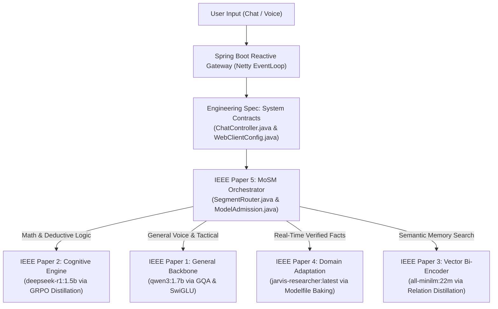

# J.A.R.V.I.S. Artificial Intelligence Research Papers & Engineering Specifications (IEEE Transactions Series)

**Laboratory:** Advanced Edge Systems & Cognitive Computing Laboratory  
**System Repository:** `d:\Jarvis\jarvis-ai`  
**Publication Collection:** IEEE Technical Report Series & System Architecture Monographs (2026 Edition)  

This directory contains the formal IEEE Transactions-style architectural research papers, mathematical derivations, CUDA/PyTorch reference implementations, and complete system engineering specifications documenting every neural network architecture, reinforcement learning algorithm, and distributed edge orchestration protocol active within the **J.A.R.V.I.S.** ecosystem.

---

## Compendium Index

| Document Identifier | Paper / Specification Title | Core Architecture & Mathematical Scope | Direct Link |
| :--- | :--- | :--- | :--- |
| **JARVIS-ENG-SPEC-2026** | *Complete System Engineering Specification & Developer Reference Manual* | **Full System Architecture Manual:** End-to-end dataflow, reactive Netty EventLoop microarchitecture, complete Java class-by-class technical review, REST/SSE API contract, vector memory RAG, and Home Assistant IoT bridge. | 📄 [Read Specification](file:///d:/Jarvis/jarvis-ai/docs/papers/PROJECT_JARVIS_COMPLETE_ENGINEERING_SPECIFICATION.md) |
| **IEEE-JARVIS-TR-2026-000** | *J.A.R.V.I.S. Master System Architecture Monograph* | **Production Engineering Monograph:** Global system topology, 10MB reactive buffer tuning, hardware profiling, and full deployment lifecycle. | 📄 [Read Monograph](file:///d:/Jarvis/jarvis-ai/docs/papers/PROJECT_JARVIS_MASTER_ARCHITECTURE.md) |
| **IEEE-JARVIS-TR-2026-001** | *Design, Mathematical Foundations, and Edge Inference Dynamics of the Qwen-1.7B Grouped-Query Transformer* | **Qwen-1.7B / 2.0B Backbone:** Exact parameter-by-parameter proof of all 1,777,080,832 weights, 6:1 Grouped-Query Attention (GQA), RoPE ($\theta = 10^6$), SwiGLU gradient dynamics, optimized CUDA C++ GQA decode kernel, and complete PyTorch forward pass. | 📄 [Read Paper 1](file:///d:/Jarvis/jarvis-ai/docs/papers/IEEE_Paper_1_Qwen_Architecture.md) |
| **IEEE-JARVIS-TR-2026-002** | *Incentivizing Emergent Chain-of-Thought Reasoning in Edge-Scale Transformers: The DeepSeek-R1 Distillation and Group Relative Policy Optimization (GRPO) Framework* | **DeepSeek-R1 Distill (1.5B):** Mathematical derivation of Group Relative Policy Optimization (GRPO), Critic-free advantage estimation, emergent `<think>` deliberation traces, complete PyTorch `GRPOLoss` implementation, and 800k-trace distillation taxonomy. | 📄 [Read Paper 2](file:///d:/Jarvis/jarvis-ai/docs/papers/IEEE_Paper_2_DeepSeek_R1_and_GRPO.md) |
| **IEEE-JARVIS-TR-2026-003** | *Deep Self-Attention Relation Distillation and Contrastive Metric Learning for Edge Vector Retrieval: The all-MiniLM-L6-v2 Bi-Encoder Architecture* | **all-MiniLM-L6-v2 (22M):** Complete proof of 22,714,368 parameters, Deep Self-Attention Relation Distillation ($\mathcal{L}_{\text{AT}} + \mathcal{L}_{\text{VR}}$), Multiple Negatives Ranking Loss (MNRL), and complete PyTorch embedding pipeline. | 📄 [Read Paper 3](file:///d:/Jarvis/jarvis-ai/docs/papers/IEEE_Paper_3_MiniLM_BiEncoder_Semantic_Memory.md) |
| **IEEE-JARVIS-TR-2026-004** | *Zero-Weight-Duplication Domain Specialization: Architectural Principles of Modelfile Baking and Grounded Hallucination Suppression in Real-Time Autonomous Agents* | **JARVIS-Researcher & Reasoner Specialization:** Modelfile virtualization, SHA-256 layer caching without VRAM duplication, mathematical proof of temperature-scaled logit entropy monotonicity ($\frac{d\mathcal{H}}{d\tau} > 0$), and complete PyTorch `StochasticSampler`. | 📄 [Read Paper 4](file:///d:/Jarvis/jarvis-ai/docs/papers/IEEE_Paper_4_Domain_Adaptation_and_Model_Baking.md) |
| **IEEE-JARVIS-TR-2026-005** | *Mixture-of-Small-Models (MoSM): Latency-Bounded Multi-Agent Dispatching, Block Quantization, and Concurrency Admission on Commodity Edge Compute* | **Edge Orchestration & Execution:** Full derivation of the Roofline Model ($I_{\text{knee}} = \Pi_{\text{peak}} / \mathcal{B}_{\text{mem}}$), decoding latency comparison across modern consumer GPUs/CPUs, reactive semaphore admission in [`ModelAdmission.java`](file:///d:/Jarvis/jarvis-ai/backend/src/main/java/com/jarvis/ai/ModelAdmission.java), and end-to-end latency waterfall. | 📄 [Read Paper 5](file:///d:/Jarvis/jarvis-ai/docs/papers/IEEE_Paper_5_MoSM_Orchestration_and_Edge_Acceleration.md) |

---

## Architectural Mapping to System Source Code

### Source Code Cross-References
* **Gateway & Router:** [`SegmentRouter.java`](file:///d:/Jarvis/jarvis-ai/backend/src/main/java/com/jarvis/ai/SegmentRouter.java)
* **Prompt Assembly & Hallucination Guardrails:** [`PromptFactory.java`](file:///d:/Jarvis/jarvis-ai/backend/src/main/java/com/jarvis/chat/PromptFactory.java)
* **Reactive Model Streaming:** [`OllamaProvider.java`](file:///d:/Jarvis/jarvis-ai/backend/src/main/java/com/jarvis/ai/OllamaProvider.java)
* **Non-Blocking Semaphore Admission:** [`ModelAdmission.java`](file:///d:/Jarvis/jarvis-ai/backend/src/main/java/com/jarvis/ai/ModelAdmission.java)
* **Semantic Vector Memory Engine:** [`KnowledgeService.java`](file:///d:/Jarvis/jarvis-ai/backend/src/main/java/com/jarvis/knowledge/KnowledgeService.java)
* **Market & Live Data Scraper:** [`RealtimeFactService.java`](file:///d:/Jarvis/jarvis-ai/backend/src/main/java/com/jarvis/realtime/RealtimeFactService.java)
* **Autonomous Web Research:** [`WebSearch.java`](file:///d:/Jarvis/jarvis-ai/backend/src/main/java/com/jarvis/search/WebSearch.java)
* **Process Automation:** [`SystemAppLauncher.java`](file:///d:/Jarvis/jarvis-ai/backend/src/main/java/com/jarvis/system/SystemAppLauncher.java)
* **IoT & Smart Home:** [`HomeAssistantClient.java`](file:///d:/Jarvis/jarvis-ai/backend/src/main/java/com/jarvis/smarthome/HomeAssistantClient.java)
